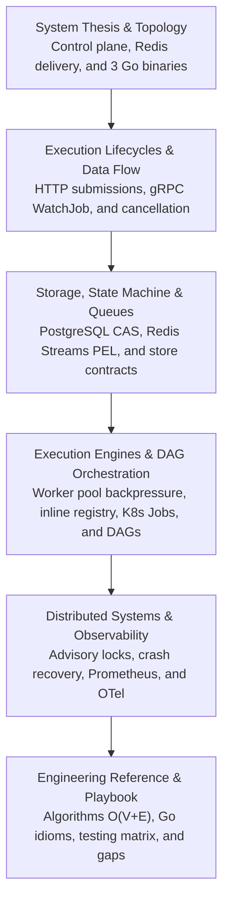

# Architecture Deep Dive

This technical reference reverse engineers the Orion repository as a distributed systems textbook. Grounded in the code present across the workspace, it guides engineers through understanding, operating, extending, or reimplementing Orion from first principles.

Orion is a Go-based distributed job orchestrator designed for lightweight tasks and machine-learning workloads. It exposes HTTP and gRPC interfaces, persists canonical state in PostgreSQL, delivers work via Redis Streams, and executes jobs either inline within worker processes or as Kubernetes `batch/v1` Jobs with GPU resource limits.

---

## Core Architecture Sections

The architecture is divided into **6 focused chapters**:

---

## Chapter Index

1. **[System Thesis & Component Topology](/docs/architecture-details/topology)**  
   The core philosophy separating durable state (PostgreSQL), delivery (Redis Streams), and compute (Workers/K8s). Physical service boundaries across the 3 production Go binaries (`orion-api`, `orion-scheduler`, `orion-worker`) and codebase ownership map.

2. **[Execution Lifecycles & Data Flow](/docs/architecture-details/lifecycles)**  
   End-to-end message traversal across process boundaries: HTTP submission to worker completion sequence, real-time gRPC `WatchJob` event streaming with PostgreSQL `LISTEN/NOTIFY`, and cross-process cancellation through Redis pub/sub.

3. **[Storage, State Machine & Queue Delivery](/docs/architecture-details/storage-queues)**  
   Durable state machine, atomic Compare-And-Swap (`TransitionJobState`) transitions, PostgreSQL schema design, and Redis Streams delivery mechanics (consumer groups, Pending Entries List recovery, and scheduled jobs Lua pop).

4. **[Execution Engines & DAG Pipeline Orchestration](/docs/architecture-details/engines-dag)**  
   Scheduler control loop, weighted fair queueing, token-bucket rate limiting, pipeline DAG advancer with cascade cancellation, bounded worker pool with goroutine channel backpressure, inline handler registry, and Kubernetes batch executor.

5. **[Distributed Systems Guarantees & Observability](/docs/architecture-details/distributed-systems)**  
   Active-passive leader election via dedicated PostgreSQL advisory locks, failure modes and crash recovery matrix, backpressure layers, Prometheus metrics family, OpenTelemetry distributed tracing, and structured JSON logging.

6. **[Engineering Reference & System Playbook](/docs/architecture-details/engineering-reference)**  
   Algorithms and Big-O complexity matrix, Go idioms and concurrency primitives, design patterns in Orion, testing strategy, deployment and security baseline, contributor mental models, and future roadmap gaps.

---

## Repository Source-of-Truth

Generated protobuf files and frontend build artifacts are not treated as authored source. Hand-authored sources of truth:

- **Go Services**: `cmd/`, `internal/`, `pkg/`
- **Protobuf Schema**: `proto/orion/v1/jobs.proto`
- **SQL Migrations**: `internal/store/migrations/`
- **Deployment Manifests**: `deploy/`, `docker-compose.yml`, `Makefile`
- **Frontend App**: `frontend/app/`, `frontend/components/`, `frontend/lib/`
- **Design History**: `docs/adr/`, `docs/phases/`, `README.md`, `RUNBOOK.md`
