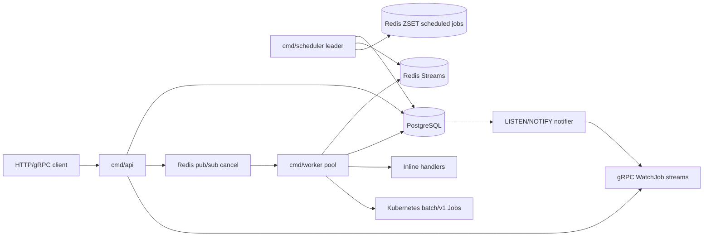

# 1. System Thesis & Component Topology

## System Thesis

Orion separates **control-plane state**, **delivery**, and **execution**.

PostgreSQL is the source of truth. Redis is not authoritative; it is a delivery transport. Workers are disposable executors. The scheduler is a singleton leader that converts durable DB intent into Redis delivery messages. The API tier creates and observes durable intent. This separation is the central design choice behind almost every package.

The resulting guarantees are deliberately practical and robust:

- **Atomic State Transitions**: Job state transitions are atomic at the PostgreSQL level using Compare-And-Swap (CAS).
- **At-Least-Once Delivery**: Queue delivery through Redis Streams is at-least-once.
- **Idempotent Execution**: Execution is made idempotent by database CAS guards, not by message broker deduplication.
- **Active/Passive Scheduler**: The scheduler is active/passive through PostgreSQL session advisory locks.
- **Worker Crash Resilience**: Workers can crash mid-job, and unacknowledged messages remain recoverable through Redis Pending Entries Lists (PEL) plus database orphan reclamation.
- **Orchestrator-Owned Retries**: Kubernetes retries are disabled (`backoffLimit: 0`) so Orion, not Kubernetes, owns attempts and retry accounting.

---

## Physical Execution Topology

There are three production Go binaries:

| Binary | Stateful? | Horizontal Scale | Main Dependencies | Primary Loop |
| :--- | :--- | :--- | :--- | :--- |
| `orion-api` | No | Yes | PostgreSQL, Redis, gRPC | Request/response plus streaming |
| `orion-scheduler` | Logically singleton | Multi-replica, single leader | PostgreSQL, Redis | Ticker-based scheduling & dispatch |
| `orion-worker` | No durable local state | Yes | PostgreSQL, Redis, Kubernetes API | Bounded worker pool & execution |

The API and workers can scale horizontally because all durable state lives in PostgreSQL. Scheduler pods can also scale horizontally, but only one active leader dispatches at a time. 

`internal/scheduler/scheduler.go` uses `pg_try_advisory_lock(7331001)` on a dedicated `pgxpool.Conn` so leadership is bound to a PostgreSQL session and released automatically on process crash or connection close.

---

## Repository Source-of-Truth Map

| Path | Architectural Role |
| :--- | :--- |
| `cmd/api` | HTTP API, gRPC API, metrics/tracing setup, PostgreSQL/Redis wiring |
| `cmd/scheduler` | Leader-elected dispatch loop, retry promotion, DAG advancement |
| `cmd/worker` | Worker pool wiring, inline handlers, Kubernetes executor wiring |
| `internal/domain` | Domain entities and in-memory state-machine helpers |
| `internal/store` | Persistence interfaces, filters, typed errors, transition options |
| `internal/store/postgres` | PostgreSQL implementation and SQL access patterns |
| `internal/queue` | Broker abstraction |
| `internal/queue/redis` | Redis Streams, scheduled ZSET, PEL reclaim, queue depth polling |
| `internal/scheduler` | Advisory-lock scheduler, token buckets, weighted fair queueing |
| `internal/pipeline` | DAG advancement and cascade cancellation |
| `internal/worker` | Bounded goroutine pool, executor interface, inline executor |
| `internal/worker/k8s` | Kubernetes Job translation, client-go watch/poll execution |
| `internal/worker/cancel` | Redis pub/sub cancellation signaler |
| `internal/api/handler` | REST handlers and HTTP middleware |
| `internal/api/grpc` | gRPC service, in-memory event broadcaster, PG notifier |
| `internal/observability` | Prometheus metrics, OpenTelemetry tracing, slog setup |
| `pkg/retry` | Generic retry/backoff utilities with full jitter |
| `proto/orion/v1/jobs.proto` | gRPC service and protobuf message schema |
| `frontend` | Next.js operational dashboard using mock/API-shaped data |
| `deploy` | Dockerfiles, Helm chart, raw Kubernetes RBAC/job manifests, Prometheus rules |
