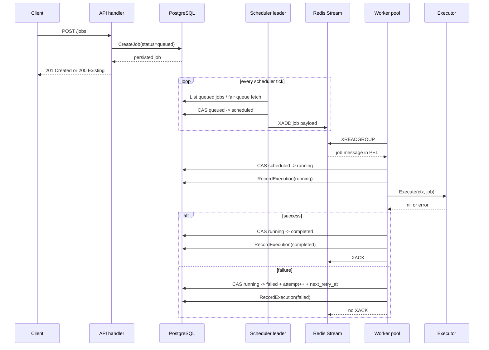
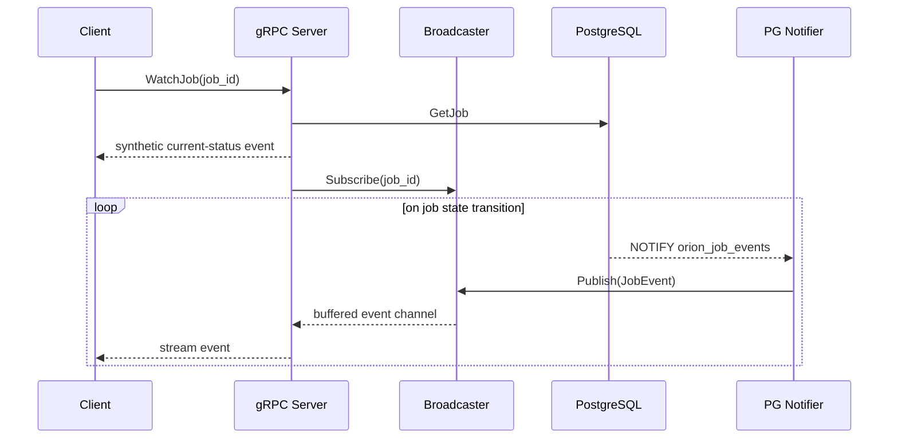

# Execution Lifecycles & Data Flow

## HTTP Job Submission To Completion

The sequence diagram below details how work moves from client submission through the database, scheduler, Redis Stream, and execution engine:

The failure path intentionally does not acknowledge Redis. That preserves at-least-once delivery in Redis, but the database state machine prevents stale or duplicate messages from causing double execution.

### Critical Flow Characteristics

1. **Idempotent Submission**: Clients pass `idempotency_key`. If identical submissions arrive concurrently, the PostgreSQL unique index enforces serialization.
2. **Dispatch CAS**: The scheduler marks `queued -> scheduled` via CAS *before* calling `XADD`. If multiple schedulers run concurrently, only one succeeds in claiming the job.
3. **At-Least-Once Delivery**: The worker receives the message via `XREADGROUP`, placing it in the Redis Pending Entries List (PEL).
4. **Execution CAS**: Before running, the worker executes `TransitionJobState(id, "scheduled", "running")`. If another worker raced or the job was cancelled, CAS fails and the message is safely dropped.
5. **Selective Acknowledgement**: 
   - On success: The worker updates PostgreSQL to `completed` and calls `XACK`.
   - On failure: The worker updates PostgreSQL to `failed` (incrementing attempt and computing next retry) and intentionally **does not call XACK**. This keeps the message pending in Redis until reclaimed or retried.

---

## Real-Time Streaming WatchJob Flow

Orion supports real-time state streaming via gRPC without continuous database polling:

### Hybrid Notification Architecture

- **PostgreSQL `LISTEN/NOTIFY`**: When a state transition occurs, `TransitionJobState` invokes `pg_notify('orion_job_events', payload)`. The API’s dedicated notifier process receives the event on a session-scoped connection and routes it to the in-memory `Broadcaster`. Notification failure is best-effort and does not roll back the committed state transition.
- **In-Memory Broadcaster**: Thread-safe pub/sub hub (`map[jobID]map[subID]chan *JobEvent`) with buffered subscriber channels (capacity 16). Uses non-blocking publish so slow subscribers never stall database writes.
- **500 ms Polling Fallback**: In `internal/api/grpc/server.go`, `WatchJob` includes a 500 ms periodic DB polling fallback. If a database notification is dropped or the connection resets, the client still receives the latest status.

---

## Cross-Process Job Cancellation Flow

`internal/worker/cancel/cancel.go` defines a Redis pub/sub `Signaler`:

- API publishes job IDs to `orion:cancel`.
- Workers subscribe and parse UUID payloads.
- Worker pool stores in-flight cancel functions in a mutex-protected map (`cancelMu`).
- When a matching ID arrives, `CancelJob` invokes the function.
- Executors and handlers must honor `ctx.Done()`.

This is eventually delivered cancellation, not a strongly consistent kill protocol. If a worker misses the pub/sub message, the DB status may still be `cancelled`, but an executor that does not poll DB state will keep running until completion or external cancellation. For Kubernetes jobs, context cancellation from the local worker triggers foreground deletion of the remote Job and Pods.

---

## API Layer & Transport Protocols

### REST Handlers

`internal/api/handler` is intentionally thin.

`job.go` exposes:
- `POST /jobs`: Create single job with idempotency key
- `GET /jobs`: List jobs with queue/status filtering
- `GET /jobs/{id}`: Retrieve job details
- `GET /jobs/{id}/executions`: Retrieve execution attempt history
- `POST /jobs/{id}/cancel`: Cancel running or scheduled job
- `POST /jobs/{id}/replay`: Re-queue completed or failed job
- `DELETE /jobs/{id}`: Delete non-active job

`pipeline.go` exposes:
- `POST /pipelines`: Create multi-node DAG pipeline
- `GET /pipelines`: List pipelines
- `GET /pipelines/{id}`: Retrieve pipeline details and DAG status
- `GET /pipelines/{id}/jobs`: Retrieve all jobs created for a pipeline
- `POST /pipelines/{id}/cancel`: Cancel pipeline and cascade-cancel children

`queue.go` exposes:
- `GET /queues`: List queue configs and runtime statistics
- `GET /queues/{name}`: Get single queue config
- `PUT /queues/{name}`: Update queue weight, rate limits, or concurrency
- `GET /queues/{name}/stats`: Runtime stream depth and metrics

`worker.go` exposes:
- `GET /workers`: List registered workers and heartbeat liveness

HTTP handlers use Go 1.22 `http.ServeMux` method/path patterns such as `"POST /jobs"` and `r.PathValue("id")`.

### Validation

- **Job submission**: Validates name, type, executor-specific payload presence, and defaults priority, queue, and max retries.
- **Pipeline creation**: Validates structural DAG rules (node uniqueness, edge references, self-loops) but not full acyclicity.
- **Queue config updates**: Validates numeric ranges (`max_concurrent >= 1`, `0 <= weight <= 1`, `rate_per_sec > 0`, `burst >= 1`).

### gRPC Service

`proto/orion/v1/jobs.proto` defines `JobService`:
- unary `SubmitJob`
- unary `GetJob`
- server-streaming `WatchJob`
- server-streaming `WatchPipeline`

`internal/api/grpc/server.go` converts between domain structs and protobuf messages. The gRPC schema includes Kubernetes payload messages, but `protoPayloadToDomain` currently only maps handler name and string args; it does not map `KubernetesSpec`. That means gRPC submission is less complete than HTTP for Kubernetes jobs.

### Broadcaster Pattern

`Broadcaster` is an in-memory pub/sub hub:
- `map[jobID]map[subID]chan *JobEvent`
- `sync.RWMutex`
- buffered subscriber channels of capacity 16
- non-blocking publish that drops when a subscriber is slow

This is a deliberate availability choice: publisher goroutines never block on slow clients. The WatchJob polling fallback recovers missed state changes.
