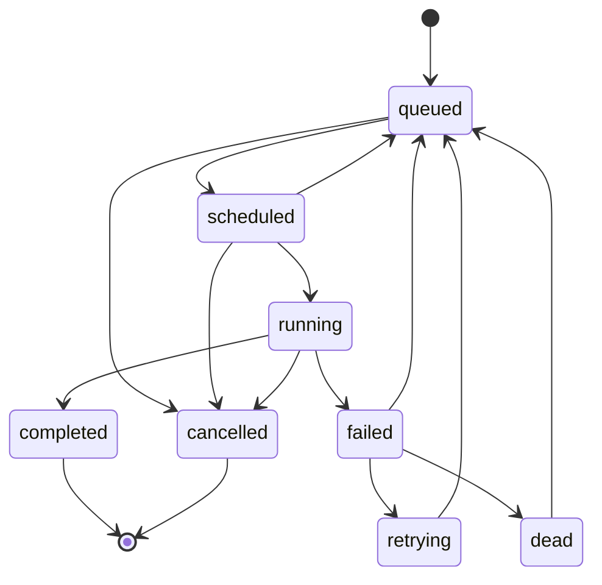

# Storage, State Machine & Queue Delivery

## Domain State Machine & Lifecycle Transitions

### Jobs

`internal/domain/job.go` defines:

- `JobStatus`: `queued`, `scheduled`, `running`, `completed`, `failed`, `retrying`, `dead`, `cancelled`.
- `ValidTransitions`: a map from current status to permitted next statuses.
- `JobType`: `inline` or `k8s_job`.
- `JobPriority`: integer-like `int8` priority constants.
- `Job`: the central durable work unit.
- `JobPayload`: either inline handler name/args or a `KubernetesSpec`.
- `KubernetesSpec`: image, command, args, namespace, resources, env vars, service account, TTL.
- `ResourceRequest`: CPU, memory, GPU request.
- `JobExecution`: immutable audit row per attempt.



The in-memory `CanTransitionTo`, `IsTerminal`, and `IsRetryable` helpers are advisory convenience checks. The actual concurrency control is in PostgreSQL via `TransitionJobState`, because only the database sees all concurrent actors.

**Tradeoff**: A Go map of valid transitions is simple and readable, but not database-enforced. PostgreSQL has a status check constraint, not a transition constraint. This is acceptable because all writes route through the store API in normal code. A stricter alternative would be a database trigger that validates state transitions, but that would move business logic into SQL and make tests and migrations heavier.

### Workers

`internal/domain/worker.go` models worker liveness and capacity:
- `Worker` has ID, hostname, queue names, concurrency, active jobs, status, heartbeat, and registration time.
- `IsAlive(ttl)` compares `LastHeartbeat` with wall-clock time.
- `AvailableSlots()` clamps negative capacity to zero.

The durable worker table is used for:
- liveness checks in `GET /workers`
- orphan reclamation in the scheduler
- operational visibility

The code does not currently keep `workers.active_jobs` continuously in sync with the worker pool's atomic counter; active count is mainly exposed through Prometheus. The table uses heartbeats and registration status for liveness.

---

## Persistence Abstractions & Store Contracts

`internal/store/store.go` is pure contracts and shared types. It defines:
- `JobStore`
- `ExecutionStore`
- `WorkerStore`
- `PipelineStore`
- `QueueConfigStore`
- composite `Store`
- filters
- functional transition options
- typed sentinel errors

The design pattern is interface segregation plus dependency inversion. The scheduler, API, worker pool, and pipeline advancer depend on `store.Store`, not on PostgreSQL. PostgreSQL is isolated in `internal/store/postgres`.

**Alternatives**:
- Direct `*postgres.DB` injection would reduce interface maintenance but make tests and future persistence backends harder.
- Smaller interfaces per consumer would be even more precise, but the repository already uses a single broad fake in tests. That is easy to understand but can force test fakes to implement methods they do not use.

### Typed Errors

`StoreError` implements `Error()` and `Is(target error) bool`. This allows `errors.Is(err, store.ErrNotFound)` even when the returned error has a detailed message. This is preferable to string matching and lets handlers map store outcomes to HTTP/gRPC status codes.

### Functional Options

`TransitionOption` mutates a `TransitionUpdateExported` struct. Callers pass `WithWorkerID`, `WithError`, `WithNextRetryAt`, `WithStartedAt`, or `WithCompletedAt` to atomically update extra columns while changing state.

This is a classic Go functional-options pattern. It avoids a long method signature with many optional pointer fields. The tradeoff is dynamic SQL construction in the PostgreSQL implementation.

---

## PostgreSQL Implementation & Atomic CAS Mechanics

`internal/store/postgres/db.go` and `pipeline.go` implement the `Store` interface with `pgx/v5` and `pgxpool`.

### Core SQL Schema

`001_initial_schema.up.sql` creates:
- `jobs`
- `job_executions`
- `workers`
- `pipelines`
- `pipeline_jobs`
- `update_updated_at()` trigger

### Important Indexes

| Index | Target Query & Operational Purpose |
| :--- | :--- |
| `idx_jobs_queued_priority` | Scheduler scans only queued jobs ordered by priority/FIFO (`priority DESC, created_at ASC`) |
| `idx_jobs_retry_eligible` | Scheduler finds failed jobs whose backoff expired (`next_retry_at <= NOW()`) |
| `idx_jobs_running_worker` | Orphan detection for running jobs mapped to dead workers |
| `idx_jobs_queue_status` | Filtered API list queries by queue and status |
| `idx_executions_job_id` | Execution history lookups by job ID |
| `idx_workers_heartbeat` | Active worker list and orphan decisions |
| `idx_pipelines_status_created` | Scheduler active-pipeline query scanning running/pending workflows |
| `idx_pipeline_jobs_pipeline_node` | Node status JOIN ordered by node ID |
| `idx_queue_config_enabled` | Active queue config scans |

### Idempotent Job Creation

`CreateJob` handles idempotency with a client-provided `idempotency_key`:

1. If a key exists, query by key first.
2. If found, return the existing job.
3. If missing, insert.
4. If insert hits PostgreSQL unique violation `23505`, fetch by key again.

This is robust to concurrent identical submissions because the unique index is the serialization point. A pure Go mutex would fail across API replicas.

### Compare-And-Swap State Transitions

`TransitionJobState` is the most important persistence primitive:

```sql
UPDATE jobs
SET status = $3, updated_at = NOW()
WHERE id = $1 AND status = $2
RETURNING id, name, COALESCE(worker_id, '')
```

If no row returns, the expected status was stale, and callers receive `store.ErrStateConflict`. This is optimistic concurrency control. It avoids distributed locks while making duplicate queue messages safe.

**Tradeoffs**:
- CAS is simple and scalable for single-row state machines.
- It requires every state writer to know the expected previous state.
- It does not protect multi-row invariants unless wrapped in transactions.
- It makes stale Redis messages cheap to discard.

### PostgreSQL LISTEN/NOTIFY

After a successful transition, `TransitionJobState` calls `pg_notify('orion_job_events', payload)`. The API's gRPC notifier listens on a dedicated connection because `LISTEN` is session-scoped.

This is best-effort: a notification failure does not roll back the already committed state change. The gRPC watch layer compensates with polling fallback.

### ClaimPendingJobs (Work-Distribution Pattern)

`ClaimPendingJobs` uses `SELECT ... FOR UPDATE SKIP LOCKED` inside a Common Table Expression (CTE) and then updates claimed rows to `scheduled`:

- `FOR UPDATE` locks candidate rows.
- `SKIP LOCKED` makes concurrent claimers skip rows already locked instead of blocking.
- The CTE plus `UPDATE ... RETURNING` claims and fetches in one statement.

In the current architecture, the scheduler owns dispatch through Redis Streams, so this method is primarily relevant to direct DB worker claiming scenarios and tests.

### Orphan Reclamation

`ReclaimOrphanedJobs` resets `running` jobs to `queued` when their worker record is missing or heartbeat is stale. This is the database-level recovery mechanism for a worker that died after a job entered `running`.

This complements Redis PEL recovery. Redis knows about messages; PostgreSQL knows about job ownership and status. Both are needed because a crash can happen at many points in the flow.

### Execution Audit

`RecordExecution` inserts into `job_executions` with `ON CONFLICT (job_id, attempt) DO NOTHING`. The table is append-only by design.

**Tradeoff**: Immutable audit rows preserve history, but duplicate attempt numbers are ignored. If callers record a `running` row and later a `failed` row for the same attempt, the unique constraint can prevent both from being stored depending on attempt numbering. The intended model is one row per attempt.

### JSONB Payloads

`jobs.payload` and `pipelines.dag_spec` are JSONB. Go marshals/unmarshals `domain.JobPayload` and `domain.DAGSpec`.

This is appropriate for ML workloads where payload shape evolves often. The tradeoff is weaker database-level validation. The code validates at API edges and executor edges instead of through relational schema.

---

## Redis Queue Implementation & Delivery Engine

`internal/queue/queue.go` defines the broker interface. `internal/queue/redis` implements it with Redis Streams.

### Streams And Consumer Groups

Known stream keys:
- `orion:queue:high`
- `orion:queue:default`
- `orion:queue:low`
- `orion:queue:dead`
- `orion:queue:scheduled` (sorted set, not a stream)

`RedisQueue.New` ensures the consumer group `orion-workers` exists for high, default, and low streams. `XGroupCreateMkStream` creates streams lazily.

`Dequeue` uses `XREADGROUP` with:
- `Group: "orion-workers"`
- stable `Consumer: consumerID`
- `Streams: []string{streamName, ">"}`
- `Count: 1`
- `Block: 5s`
- `NoAck: false`

The message is then in the Redis Pending Entries List (PEL) until `AckFunc(nil)` calls `XACK`.

### Ack Function Semantics

- `AckFunc(nil)` acknowledges and removes the message from the PEL.
- `AckFunc(nonNil)` intentionally does not acknowledge. The message remains pending and can later be reclaimed.

This implements at-least-once delivery. The worker and store CAS logic are what make duplicate delivery tolerable.

### PEL Reclaim

`ReclaimStalePending` periodically calls `XAUTOCLAIM` for each known stream. Claimed messages are re-added to the stream with `XADD`, then the old pending IDs are acknowledged. This avoids permanent accumulation under the `"reclaimer"` consumer.

Complexity per sweep is `O(Q * C)`, where `Q` is number of queues and `C` is the claim count cap, currently 100.

### Scheduled Jobs

Future-scheduled jobs are stored in Redis sorted set `orion:queue:scheduled` using `scheduled_at.Unix()` as score. `StartScheduledSweeper` runs every second. `sweepScheduled` uses a Lua script to atomically:
1. `ZRANGEBYSCORE` due members
2. `ZREM` those members
3. return popped members

Atomic pop matters if multiple sweepers accidentally run. The scheduler leader contract says only the leader should run it, but the Lua script is an extra safety layer.

### Queue Name Mapping

`streamForQueue` maps exact full queue constants for high and low; all other names map to default. This is conservative but surprising when callers use logical names like `"high"` or `"default"`. API comments mention logical names, while code often stores full Redis keys such as `orion:queue:high`. Contributors should normalize queue names explicitly before extending queue APIs.
