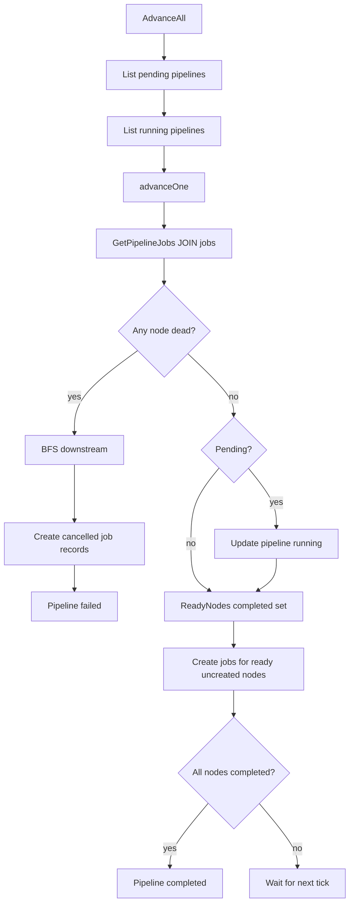

# Execution Engines & DAG Pipeline Orchestration

## Scheduler Engine & Control Loop

`internal/scheduler/scheduler.go` is the control-plane loop driving job dispatching, retries, and pipeline progression.

### Leader Election

The scheduler contends for a PostgreSQL advisory lock on a dedicated `pgxpool.Conn`:

```sql
SELECT pg_try_advisory_lock(7331001)
```

Advisory locks are session-scoped. Using an ordinary pooled connection could silently release the lock when `pgxpool` rotates connections.

**Alternatives**:
- *Kubernetes Lease leader election*: Ideal for K8s-only deployments, but ties scheduler liveness to the Kubernetes API.
- *Redis lock*: Less attractive because Redis is not the canonical source of truth.
- *etcd/ZooKeeper*: Stronger coordination but operationally heavier.

The design also provides a second safety layer: even if two schedulers dispatch concurrently, database CAS guards on `queued -> scheduled` prevent double state transitions.

### Scheduler Tick Work

Every schedule tick (default 1s):
1. `scheduleQueuedJobs`
2. `promoteRetryableJobs`
3. `advancer.AdvanceAll`

Every orphan tick:
1. `reclaimOrphanedJobs`

The scheduler's main loop is single-threaded except for the scheduled-job sweeper goroutine. This keeps reasoning simple and deterministic.

### Retry Promotion

`promoteRetryableJobs` queries failed jobs where `next_retry_at <= NOW()` and `attempt < max_retries`, then transitions `failed -> retrying -> queued`.

Backoff delay is computed by workers in `nextRetryTime` using `pkg/retry.FullJitterBackoff(job.Attempt, 5s, 30m)`. Full jitter chooses uniformly from `[0, min(cap, base * 2^attempt))`, eliminating thundering herds after shared downstream outages.

---

## Weighted Fair Queueing & Token-Bucket Rate Limiting

### Weighted Fair Dispatch

`internal/scheduler/fairqueue.go` implements weighted fetch limits across priority queues:

`ComputeAllocations` sorts queues by descending weight using insertion sort, then assigns `int(batchSize * weight)` slots while remaining capacity exists.

Complexity:

| Operation | Time Complexity | Space Complexity |
| :--- | :--- | :--- |
| `sortByWeightDesc` | `O(Q^2)` | `O(1)` |
| `ComputeAllocations` | `O(Q^2)` due to sort | `O(Q)` |
| `FetchReadyJobs` | `O(Q)` DB queries + result size | `O(N)` |

`Q` is tiny (normally 3: high, default, low), so insertion sort is optimal.

**Tradeoff**: This is weighted priority, not strict weighted fair queueing with deficit carryover. If weights sum above 1, later queues can receive zero when earlier queues are full. Unused capacity flows downward only because actual fetches may return fewer jobs than requested; allocation itself does not rebalance after observing queue depths.

### Token Bucket Rate Limiter

`internal/scheduler/ratelimiter.go` implements per-queue token buckets with:
- `tokens float64`
- `maxTokens float64`
- `refillRate float64`
- `lastRefill time.Time`
- global `sync.Mutex`

`Allow(queue)` lazily refills based on elapsed seconds, caps at burst, and consumes one token if available. Complexity is `O(1)` per call. The mutex serializes all queues; with one scheduler leader and a single dispatch goroutine, this introduces negligible contention.

---

## Pipeline Advancer & Multi-Stage DAG Workflows

`internal/pipeline/advancement.go` is a stateless DAG engine called by the scheduler leader every tick.

### Graph Representation

`internal/domain/pipeline.go` defines:
- `PipelineStatus`: `pending`, `running`, `completed`, `failed`, `cancelled`
- `Pipeline`: name, status, DAG spec, timestamps
- `DAGSpec`: adjacency-list graph as `Nodes []DAGNode` and `Edges []DAGEdge`
- `DAGNode`: logical node ID, job template, optional created Job ID
- `DAGEdge`: source and target, where target depends on source
- `ReadyNodes(completed map[string]bool) []string`

`ReadyNodes` builds a dependency map from edges, then scans every node and returns nodes whose dependencies are all present in `completed`.

Complexity:

| Function | Time Complexity | Space Complexity | Why |
| :--- | :--- | :--- | :--- |
| `DAGSpec.ReadyNodes` | `O(V + E)` | `O(E + R)` | Builds dependencies then scans nodes |
| `findNode` | `O(V)` | `O(1)` | Linear search through node slice |
| `findDownstream` | `O(V + E)` | `O(V + E)` | BFS over adjacency list |
| `allNodesCompleted` | `O(V)` | `O(1)` | Checks each DAG node |

The code validates node uniqueness, backend presence, edge references, and self-loops in `internal/api/handler/pipeline.go`. It does **not** currently perform a full cycle-detection DFS; a cycle would cause no nodes in the cycle to become ready, leaving a pipeline stuck in `running`.

### Advancement Algorithm

For each pipeline:
1. Fetch current `pipeline_jobs` joined with job status.
2. Build `completed` set and `createdNodes` map.
3. If any created node is `dead`, create cancelled downstream job records and mark pipeline failed.
4. Transition `pending -> running` on first touch.
5. Compute ready node IDs from DAG dependencies.
6. For each ready uncreated node, create a job and link it to the pipeline.
7. If all nodes are completed, mark pipeline completed.



The advancer is idempotent at the algorithm level through `createdNodes`, and at the database level through `AddPipelineJob` using `ON CONFLICT DO NOTHING`.

**Potential Issue**: `pipeline_jobs` primary key is `(pipeline_id, job_id)`, not `(pipeline_id, node_id)`. The in-memory guard prevents normal duplication, but a crash between `CreateJob` and `AddPipelineJob` can still create orphan job rows. A unique constraint on `(pipeline_id, node_id)` would better enforce the logical invariant.

---

## Bounded Worker Pool & Goroutine Backpressure

`internal/worker/pool.go` is a bounded concurrent executor.

### Concurrency Shape

For each configured queue, a dequeue goroutine calls `Queue.Dequeue`. `cfg.Concurrency` worker goroutines read from a shared buffered channel:

```go
jobCh := make(chan *jobTask, cfg.Concurrency)
```

This pattern provides backpressure: when all worker slots are busy and the channel buffer is full, dequeue goroutines block on send. Jobs remain in Redis or its PEL instead of accumulating unboundedly in process memory.

Concurrency primitives:

| Primitive | Location | Purpose |
| :--- | :--- | :--- |
| Goroutines | `Start`, `dequeueLoop`, `heartbeatLoop`, cancel listener | Concurrent IO and execution |
| Buffered channel | `jobCh` | Bounded handoff and backpressure |
| `sync.WaitGroup` | `wg`, `dequeueWg` | Clean shutdown ordering |
| `atomic.Int32` | `activeCount` | Lock-free active job gauge |
| `sync.Mutex` | `cancelMu` | Protects job ID to cancel func map |
| Contexts | All methods | Shutdown, deadlines, cancellation |

### Shutdown

`Start` blocks in `dequeueLoop` until context cancellation, then calls `drain`. `drain` waits for dequeue goroutines before closing `jobCh`, avoiding send on closed channel panics. It waits up to `ShutdownTimeout` for workers to finish.

### Execution State Machine

For each task:
1. `MarkJobRunning`
2. `RecordExecution(running)`
3. Resolve executor by `CanExecute`
4. Apply deadline with `context.WithDeadline`
5. Wrap with `context.WithCancel` and register cancel function
6. Execute
7. Mark completed or failed/cancelled
8. Record terminal execution
9. Acknowledge or not acknowledge Redis

The worker handles `ErrStateConflict` on `MarkJobRunning` by fetching current state. This is critical for stale Redis messages:
- If another worker owns it, ACK stale message.
- If this worker already owns it after restart, proceed.
- If terminal/unexpected, ACK and skip.

---

## Inline Execution Engine

`internal/worker/inline.go` defines:
- `HandlerFunc`
- `Registry`
- `InlineExecutor`

The registry is a `map[string]HandlerFunc` protected by `sync.RWMutex`. This is the right lock choice for a read-heavy registry: handlers are registered at startup and looked up for every job.

`Register` panics for empty names or nil functions. This treats handler misconfiguration as a startup programming error. Returning errors would make startup plumbing noisier and could let a service run in a partially configured state.

`argKeys` logs only argument keys, not values, eliminating accidental leakage of secrets or PII.

Built-in handlers in `internal/worker/handlers/handlers.go`:
- `Noop`: Smoke test.
- `Echo`: Payload propagation test.
- `AlwaysFail`: Retry/dead-letter test.
- `Slow`: Canonical context-aware long-running handler.
- `PanicRecover`: Decorator converting panics into errors.

---

## Kubernetes Batch Job Engine & ML Workloads

`internal/worker/k8s` implements Kubernetes-backed execution.

### Client Construction

`BuildK8sClient` uses:
- `rest.InClusterConfig()` when `ORION_K8S_IN_CLUSTER=true`
- `clientcmd.BuildConfigFromFlags("", kubeconfigPath)` otherwise
- `kubernetes.NewForConfig`

The executor stores `kubernetes.Interface`, not `*kubernetes.Clientset`, making it fully testable with `fake.NewSimpleClientset`.

### Job Translation

`spec.go` maps `domain.KubernetesSpec` into `batchv1.Job`:

| Field | Value | Reason |
| :--- | :--- | :--- |
| Job name | `orion-<uuid-prefix>` | Readable, DNS-compatible |
| Labels | `orion-job-id`, `orion-job-name`, `managed-by` | Traceability and filtering |
| `BackoffLimit` | `0` | Orion owns retries and backoff |
| `RestartPolicy` | `Never` | Failures surface immediately to Orion |
| `Completions`/`Parallelism` | `1` | One pod per job attempt |
| Requests == Limits | Guaranteed QoS | Eliminates eviction risk for ML/GPU pods |
| GPU resource | `nvidia.com/gpu` | Standard NVIDIA device plugin |
| TTL | `86400` seconds | Automatic cleanup of completed jobs |

### Watch With Poll Fallback

`Execute` creates the Kubernetes Job and calls `waitForCompletion`. `waitForCompletion` opens a Kubernetes watch with field selector `metadata.name=<jobName>`. On watch failure, closed channel, or error event, it falls back to polling `Get` every configured interval (default 2s).

### Cancellation Cleanup & Code Note

On context cancellation or deadline, `Execute` attempts foreground deletion of the Kubernetes Job. Foreground propagation asks Kubernetes to delete dependent Pods before the owner Job is deleted, preventing orphan GPU pods.

**Code Note**: The check
```go
if execErr != nil && errors.Is(execErr, context.Canceled) || errors.Is(execErr, context.DeadlineExceeded)
```
relies on Go operator precedence (`&&` before `||`). While safe because `errors.Is(nil, ...)` is false, explicit parentheses improve clarity.

---

## Kubernetes Concepts Present And Absent

### Present
- `client-go` typed clientset via `kubernetes.Interface`
- In-cluster and kubeconfig client construction
- `batch/v1 Job` creation
- Job watch and poll fallback
- Pod template specs, labels, and annotations
- Resource requests/limits and Guaranteed QoS
- GPU resource requests (`nvidia.com/gpu`)
- Service accounts, ClusterRole, and ClusterRoleBinding
- NetworkPolicy, HPA, and ServiceMonitor
- Helm templating and migration Jobs
- Liveness/readiness probes, PodDisruptionBudget, and topology spread constraints

### Absent
- No Kubernetes `controller-runtime` manager
- No Custom Resource Definitions (CRDs) or Custom Resources
- No reconciliation loop over Kubernetes-owned desired state
- No shared informers or `client-go` workqueues
- No admission webhooks
- No Kubernetes Lease-based leader election

The scheduler's tick loop is a reconciliation-like control loop over PostgreSQL state, not a Kubernetes controller. Kubernetes is an execution backend, not Orion's control-plane database.
